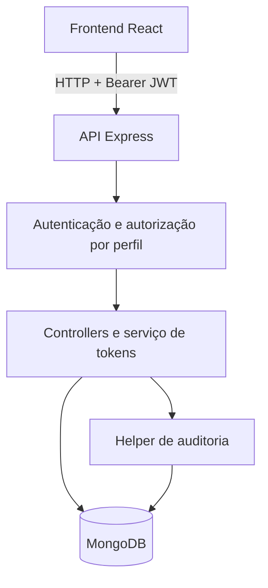
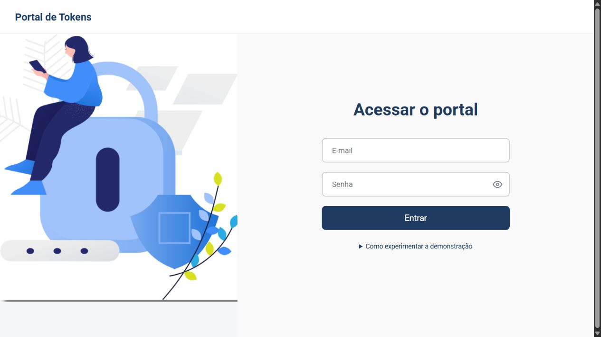
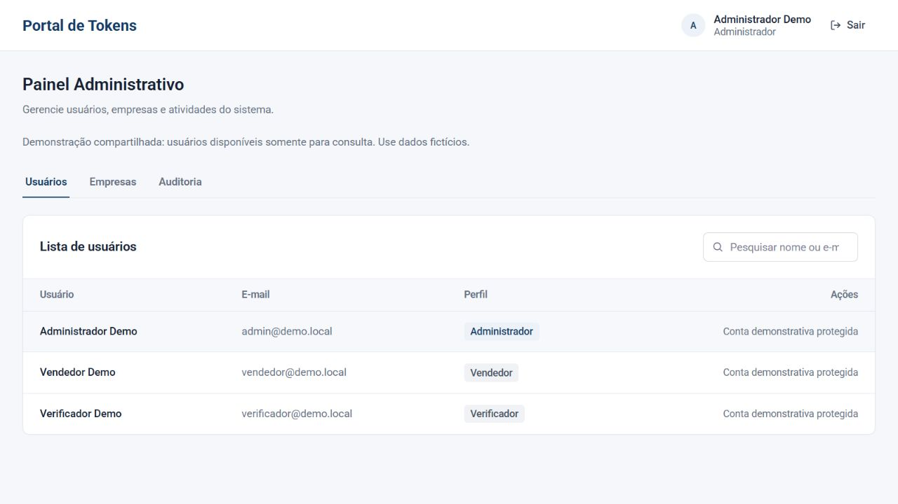
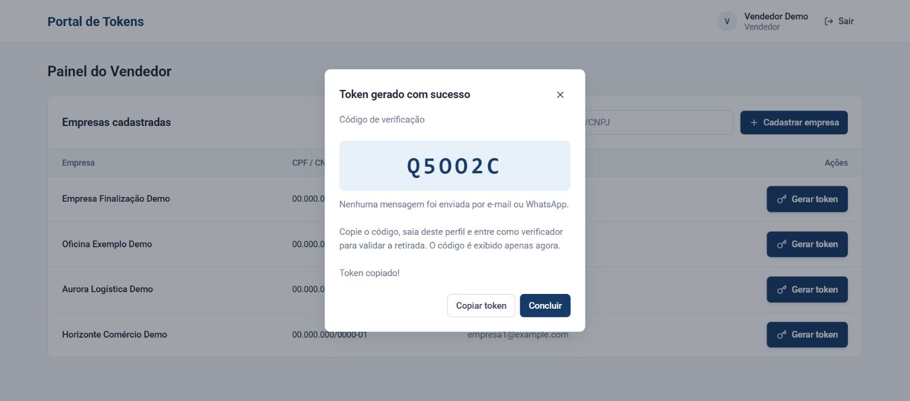
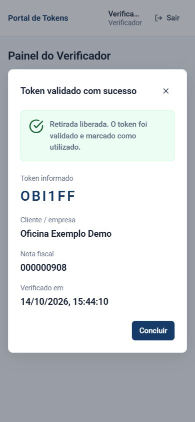

# Portal de Tokens

Aplicação full stack para gerar e validar códigos de retirada de pedidos vinculados a notas fiscais, com autenticação JWT, três perfis de acesso e histórico de operações.

Criado para uma necessidade empresarial e adaptado para portfólio público com identidade neutra, dados fictícios e integrações de mensagens desabilitadas no fluxo de geração. A separação entre vendedor, verificador e administrador representa responsabilidades distintas na emissão, liberação e gestão do acesso.

## Demonstração online

[Portal de Tokens](https://tokens-theta-dun.vercel.app/)

Verificação em 14/10/2026: o frontend carrega, mas **a demonstração completa permanece indisponível**. O bundle aponta para a API Render, que respondeu HTTP 502 nesta revisão. O painel confirma frontend em `eec58ac` e último backend publicado com sucesso em `96548fe`. O deploy do backend mais novo compilou, mas falhou ao iniciar por `JWT_SECRET` abaixo do mínimo de 32 caracteres. A versão antiga exige canal externo; não tente contornar o erro escolhendo e-mail ou WhatsApp. [Estado e evidências](docs/PUBLICACAO.md).

### Acessos públicos de teste

Credenciais da hospedagem, fornecidas pelo autor para a demonstração:

| Perfil | E-mail | Senha pública |
| --- | --- | --- |
| Administrador | admin@admin.com | `123$qwer` |
| Vendedor | vendedor@vendedor.com | `123$qwer` |
| Verificador | verificador@verificador.com | `123$qwer` |

As credenciais são públicas intencionalmente e qualquer visitante pode utilizá-las. Use somente dados fictícios, nunca informações empresariais reais. Essas identidades são protegidas no código corrigido; as proteções ainda precisam ser publicadas. Os logins foram confirmados na etapa anterior, mas não foram revalidados nesta revisão com a API indisponível. Nunca use essas senhas em contas reais.

### Como experimentar

O roteiro abaixo descreve a versão corrigida, validada localmente. **No endereço público, aguarde a atualização autorizada da API e a confirmação do fluxo completo.** Não é necessário configurar um ambiente local para usar a demonstração depois da publicação.

1. Abra o link acima e entre como **Vendedor**.
2. Selecione uma empresa fictícia ou cadastre outra com dados de teste.
3. Informe uma NF de nove dígitos, por exemplo `000000101`, e clique em **Gerar token**.
4. Copie o código exibido no modal. A versão corrigida não envia mensagens externas.
5. Saia e entre como **Verificador**; informe o código e confirme a verificação.
6. Repita a tentativa com o mesmo código: a segunda retirada deve ser recusada.
7. Consulte pendências e retiradas; depois entre como **Administrador** para consultar usuários, empresas e auditoria.

Os perfis separam emissão, liberação da retirada e administração. As contas são compartilhadas; outros visitantes podem adicionar dados fictícios enquanto você navega.

## Funcionalidades por perfil

| Perfil | Responsabilidades |
| --- | --- |
| Administrador | Consultar usuários, empresas e auditoria; administrar usuários quando a conta não é demonstrativa |
| Vendedor | Cadastrar empresas fictícias e gerar tokens vinculados à NF |
| Verificador | Validar retirada, consultar tokens pendentes e utilizados no dia |

Contas demonstrativas administradoras possuem acesso de consulta aos usuários. A autorização é feita na API; esconder botões não é a proteção de segurança.

## Tecnologias e arquitetura

React 19, Vite 7, React Router, Axios e CSS no frontend. Node.js, Express 5, TypeScript em modo estrito, Mongoose, MongoDB, JWT, bcrypt e Helmet no backend. Testes com o runner nativo do Node e MongoDB temporário.



As rotas aplicam autenticação, autorização e limites. Controllers validam contratos HTTP; o serviço de tokens trata colisões; modelos definem estrutura e índices. Diálogos, tabelas e campos são compartilhados entre painéis. Os painéis carregam sob demanda.

## Segurança e integridade

- Códigos de seis caracteres com pelo menos um número, gerados com `crypto.randomInt`. Somente SHA-256 é persistido; o código aparece no resultado da geração autorizada e não é salvo em URL ou localStorage.
- Índice único em `tokenHash` e até cinco tentativas em colisão. Falha controlada em HTTP 503, sem sobrescrita. A inicialização aguarda índices e recusa dados incompatíveis; veja o diagnóstico somente leitura antes de migrar bases existentes.
- Consumo com `findOneAndUpdate` condicionado a hash, `used: false` e validade futura: apenas uma retirada vence entre requisições concorrentes.
- Validade de 30 dias, verificada na própria operação. TTL remove registros expirados de forma assíncrona; a unicidade cobre os registros retidos.
- JWT revalidado contra o usuário atual em cada requisição. Usuário removido ou mudança de perfil invalidam a sessão anterior.
- Contas públicas protegidas também nos endpoints alternativos; admin demo não modifica usuários comuns. Empresas fictícias iniciais protegidas e cota compartilhada de 30 escritas/hora por conta demo.
- Auditoria de geração, consumo e cadastros, sanitizada recursivamente na escrita e leitura. Falhas secundárias têm registro seguro e não transformam uma retirada efetivada em falso erro HTTP. **A auditoria não é transacional e pode ficar incompleta.**
- E-mails normalizados, nomes e senhas validados, CPF/CNPJ por tipo e comprimento, telefone E.164 e índice único de documento. A validação não consulta órgãos oficiais nem verifica dígitos verificadores dos documentos fictícios.
- Limitadores independentes com limpeza de IPs inativos, memória limitada e `Retry-After`. CORS explícito, JSON até 32 KiB e headers Helmet. Proxy confiável e HSTS exigem configuração explícita.

[Detalhes, limites e migração segura](docs/INTEGRIDADE.md).

## Capturas reais

Capturas da versão local corrigida, utilizando exclusivamente o banco temporário e dados fictícios. Não representam o estado do deploy público.

| Login | Administração |
| --- | --- |
|  |  |

| Geração | Verificação |
| --- | --- |
|  |  |

[Auditoria](docs/images/audit.jpg) · [Modal em celular](docs/images/mobile.jpg)

## Executar localmente

Requisitos: Node.js 24.15+ (linha 24) ou 22.22.2+, npm e MongoDB **local e isolado**. O CI testa as linhas 22 e 24. Não aponte exemplos ou seeds para um banco empresarial.

```powershell
npm run setup
Copy-Item backend/.env.example backend/.env
Copy-Item frontend/.env.example frontend/.env
node -e "console.log(require('crypto').randomBytes(32).toString('hex'))"
```

Preserve `.env` preexistentes. Configure `MONGO_URI=mongodb://127.0.0.1:27017/portal_tokens_demo`, `JWT_SECRET` com o valor gerado (mínimo 32 caracteres) e `VITE_API_URL=/api`. Nenhuma chave SMTP/Vonage é necessária.

```powershell
npm --prefix backend run seed
npm start
```

O seed exige nome terminado em `_demo` e banco vazio ou marcador conhecido. É idempotente: não apaga dados e não redefine senhas existentes. Frontend em `http://localhost:5173`; API em `http://localhost:3003/api`. Health check em `/api/health`.

### Contas do seed local

| Perfil | E-mail | Senha pública |
| --- | --- | --- |
| Administrador | admin@demo.local | `DemoTokens!2026` |
| Vendedor | vendedor@demo.local | `DemoTokens!2026` |
| Verificador | verificador@demo.local | `DemoTokens!2026` |

Não há login automático nem bypass de autenticação. Essas contas diferem das contas existentes na hospedagem.

### Experimentar o fluxo local

1. Entre como vendedor e escolha uma empresa fictícia.
2. Gere o token com uma NF de nove dígitos, por exemplo `000000101`.
3. Copie o código exibido; e-mail e WhatsApp permanecem desabilitados.
4. Saia, entre como verificador e valide o código.
5. Repita a verificação para conferir a recusa do segundo uso.
6. Consulte o registro com o administrador demo.

### Base existente

Não remova registros para criar índices. Antes de atualizar uma base conhecida e autorizada, configure seu nome exato e execute o diagnóstico:

```powershell
$env:INTEGRITY_DB_NAME="portal_tokens_demo"
npm --prefix backend run check:integrity
```

O comando imprime contagens e o estado dos índices esperados, sem valores de registros. Não cria coleções, índices ou dados. Verifica hashes legados, documentos, e-mails equivalentes após normalização e índices únicos/TTL. Saída com código 1 indica diagnóstico recusado, indisponível ou pendências; índice ausente não autoriza criá-lo remotamente. [Migração](docs/INTEGRIDADE.md) · [Plano de publicação e rollback](docs/DEPLOY.md).

## Testes e builds

```powershell
npm --prefix backend test
npm --prefix frontend test
npm --prefix frontend run build
npm --prefix backend audit
npm --prefix frontend audit
```

O teste do backend inclui compilação TypeScript. Testes HTTP usam MongoDB temporário, sem credenciais externas; integrações SMTP/Vonage utilizam mocks e transporte MIME local, sem envio real. A primeira execução pode baixar o binário MongoDB do fornecedor. Se houver bloqueio de escrita na pasta temporária do Windows, configure `TEMP` e `TMP` para uma pasta de testes gravável e isolada.

Cobertura inclui autenticação, perfis, identidades demo, colisões e esgotamento, índices únicos, consumo concorrente real, expiração, auditoria, falhas secundárias, sanitização, validação, seed idempotente, recusa de banco desconhecido, CORS, headers, payload e rate limiting. Testes de utilitários frontend não substituem validação visual e de interação no navegador.

## CI

[Workflow de qualidade](.github/workflows/ci.yml): pull requests para `master`, pushes em `master` e na branch de melhorias. Matriz Node 22/24, `npm ci` em cada pacote, TypeScript, testes backend/frontend, build frontend e auditoria de dependências de produção. Permissão somente leitura de conteúdo; nenhum deploy configurado no workflow.

O resultado real deve ser consultado na aba Actions do commit/PR; a existência do YAML não comprova execução bem-sucedida.

## Integrações e limitações

Nodemailer/SMTP/MJML e Vonage Messages API possuem implementações preservadas da solução original, incluindo templates, validações e tratamento de erros. A geração da versão corrigida **não chama os provedores**, mesmo que o cliente peça envio. Credenciais de integração não habilitam mensagens. Reativação exigiria uma mudança explícita no fluxo. Testes usam mocks ou transporte MIME local; não houve validação de envio real nesta auditoria. **O backend hospedado antigo ainda possui envio no fluxo; a desativação pública só pode ser afirmada após sua atualização e validação.** [Integração WhatsApp](backend/WHATSAPP.md).

A demonstração compartilha cadastros e não oferece isolamento por visitante. Limitadores são por processo; múltiplas instâncias precisam de armazenamento compartilhado antes de escalar. Não há limpeza automática, reset destrutivo, garantia transacional de auditoria, revogação imediata de JWT no logout ou unicidade de código após exclusão TTL. JWT em localStorage mantém risco de exposição por XSS; migração HttpOnly exige revisão do contrato de autenticação.

Vários tokens ativos para a mesma empresa/NF continuam permitidos. A regra de reemissão depende de decisão de negócio. O [estado da publicação](docs/PUBLICACAO.md) distingue testes locais de verificação externa.

## Autor e licença

[Guilherme Lima](https://github.com/guilhermehgl). Contato profissional pelo perfil GitHub.

Licença de reutilização pendente de confirmação dos direitos aplicáveis. Nenhuma licença MIT/Apache foi adicionada. A licença das fontes Roboto permanece preservada. O histórico anterior contém identidade empresarial antiga e não foi reescrito.
