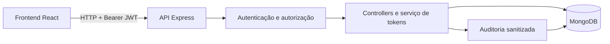

# Portal de Tokens

Sistema Full Stack para geração e validação de códigos de retirada de pedidos, desenvolvido com React, Node.js, TypeScript e MongoDB.

A aplicação organiza o trabalho de vendedores, verificadores e administradores, com controle de acesso, códigos de uso único e rastreabilidade das operações. Desenvolvida a partir de uma necessidade empresarial real e adaptada para demonstração pública e portfólio.


*Captura real da versão local corrigida, com dados fictícios. Não comprova o funcionamento do ambiente hospedado.*

## Funcionalidades

| Perfil | O que permite fazer |
| --- | --- |
| Administrador | Consultar usuários, empresas, auditoria e cotas. Criar, editar, redefinir senha e excluir usuários criados na demonstração; editar empresas permitidas. As contas públicas e os registros iniciais são protegidos. |
| Vendedor | Cadastrar empresas e gerar códigos de retirada vinculados a notas fiscais. Visualizar e copiar o token gerado. |
| Verificador | Validar códigos e confirmar retiradas; consultar pendências e tokens utilizados no dia. |

O fluxo central é **cadastrar empresa → gerar token para uma NF → copiar código → verificar retirada**. O administrador pode criar vendedores e verificadores com e-mails fictícios terminados em `.test` ou `.example`, sem criar outros administradores. Um código vencido ou já utilizado não libera uma segunda retirada. As operações relevantes geram registros de auditoria; os dados de entrada são validados pela API.

<details>
<summary>Mais telas da aplicação</summary>

| Login | Administração |
| --- | --- |
|  |  |

| Verificação | Auditoria |
| --- | --- |
|  |  |

[Ver o modal em celular](docs/images/mobile.jpg). As capturas utilizam banco temporário e dados fictícios. A captura de login registra a versão anterior às orientações de acesso por ambiente e apresentação de auditoria de usuários.

</details>

## Funcionamento original e demonstração pública

O Portal de Tokens nasceu de uma necessidade empresarial real: controlar a retirada de mercadorias vinculadas a notas fiscais. No fluxo original, o vendedor identifica a empresa e a NF, solicita um código e o sistema o associa à retirada. O código pode ser encaminhado ao contato da empresa por e-mail ou WhatsApp. O destinatário o apresenta na retirada; o verificador informa o token, a aplicação verifica sua validade e impede reutilização. As operações relevantes ficam na auditoria.

| Característica | Solução original | Demonstração pública |
| --- | --- | --- |
| Geração vinculada à empresa e NF | Implementada | Disponível |
| E-mail | Nodemailer/SMTP e HTML com MJML implementados | Desabilitado no fluxo |
| WhatsApp | Vonage Messages API, texto e imagem com legenda implementados | Desabilitado no fluxo |
| Exibição e cópia do código na tela | Adaptação para o portfólio | Disponível |
| Validade, retirada única e auditoria | Implementadas | Disponíveis |

O e-mail preserva template com código, NF e validade, validação de configuração SMTP e tratamento de falhas. O WhatsApp preserva autenticação JWT RS256, validação de telefone, composição da mensagem e tratamento de respostas/erros; a imagem é opcional conforme configuração. **Integração implementada não significa entrega certificada em produção empresarial**: testes atuais usam mocks ou transporte local; observações anteriores estão identificadas como históricas na [referência técnica](backend/WHATSAPP.md).

Na demonstração, o vendedor gera e copia o código na tela, e o verificador confirma a retirada; a recusa de reutilização e a auditoria permanecem ativas. **Não há envio real de e-mail ou WhatsApp.** Os serviços, templates, validações e tratamentos de erro continuam no repositório, desconectados da geração. Adicionar credenciais ou forçar outro `deliveryChannel` não os ativa: a reativação exigiria alteração explícita do código. Essa adaptação evita mensagens não autorizadas e permite experimentar o portal sem depender de provedores externos.

## Tecnologias

| Camada | Tecnologias |
| --- | --- |
| Interface | React 19, JavaScript, Vite 7, React Router, Axios e CSS |
| API | Node.js, Express 5 e TypeScript em modo estrito |
| Persistência e acesso | MongoDB, Mongoose, JWT, bcrypt e Helmet |
| Qualidade | Runner de testes do Node.js, MongoDB temporário e GitHub Actions |
| Integrações preservadas | Nodemailer/SMTP, MJML e Vonage Messages API |

## Arquitetura e decisões técnicas



As rotas verificam sessão, perfil e limites de requisições. Controllers validam os contratos HTTP, o serviço de tokens trata colisões e os modelos definem estrutura e índices. O frontend compartilha formulários, tabelas e diálogos, com painéis carregados sob demanda.

- **Códigos e armazenamento:** seis caracteres, pelo menos um número e geração com `crypto.randomInt`. Somente o SHA-256 é persistido. O código aparece no resultado autorizado, sem ser salvo em URL ou localStorage. Colisões são tratadas com índice único e até cinco tentativas.
- **Retirada única:** `findOneAndUpdate` condiciona o consumo ao hash, ao estado não utilizado e à validade futura. Entre retiradas concorrentes com o mesmo código, apenas uma vence.
- **Expiração:** validade de 30 dias verificada na operação; o índice TTL remove registros vencidos de forma assíncrona. A unicidade cobre os registros ainda retidos.
- **Autenticação e autorização:** JWT, senhas com bcrypt e permissões verificadas no backend. A existência, atividade e o perfil atual do usuário são revalidados. As três contas públicas e as contas iniciais do seed são protegidas; usuários criados na demonstração são identificados pelo servidor e podem ser gerenciados.
- **Auditoria:** registros sanitizados na escrita e na leitura. A gravação é best effort: uma falha secundária não transforma uma retirada efetivada em falso erro, mas pode deixar o histórico incompleto.
- **Proteções HTTP e validação:** limites por IP e conta demonstrativa, CORS explícito, Helmet, JSON limitado e validação de cadastros. CPF/CNPJ são verificados por tipo e formato, sem consulta oficial ou dígitos verificadores.

As cotas globais são persistentes no MongoDB: até **50 usuários ativos**, **50 empresas ativas** e **10 tokens por dia**, compartilhados por todos os visitantes. O dia muda à meia-noite de **America/Sao_Paulo**. Transações impedem ultrapassar a capacidade com requisições concorrentes; reiniciar o servidor ou mudar de conta/IP não libera a cota. Consultas, edições permitidas e verificação continuam disponíveis quando a capacidade acaba. As cotas exibidas nos painéis vêm da API.

Os limites conhecidos — incluindo JWT em localStorage, limitadores auxiliares por processo, auditoria não transacional e demonstração compartilhada — estão em [Integridade e segurança](docs/INTEGRIDADE.md).

## Demonstração e acessos

[Experimentar a demonstração pública](https://tokens-theta-dun.vercel.app/).

Frontend e backend foram publicados em `9360622`; o PR #1 foi integrado à `master` em `8cadd15`, com conteúdo equivalente e CI aprovado. Em 16/10/2026, foram validados os três perfis, CRUD demonstrativo, auditoria, geração/cópia, retirada e recusa de reutilização. Nesta revisão, os três logins e a consulta das cotas responderam corretamente, sem criar ou alterar registros. [Evidências e histórico da publicação](docs/PUBLICACAO.md).

Qualquer visitante pode utilizar as três contas hospedadas abaixo para experimentar a aplicação. Elas são públicas intencionalmente e protegidas contra edição, redefinição de senha e exclusão. Use apenas informações fictícias; não reutilize essas senhas em contas reais.

| Perfil | Ambiente hospedado | Seed local |
| --- | --- | --- |
| Administrador | admin@admin.com | admin@demo.local |
| Vendedor | vendedor@vendedor.com | vendedor@demo.local |
| Verificador | verificador@verificador.com | verificador@demo.local |
| Senha compartilhada | `123$qwer` | `DemoTokens!2026` |

As contas hospedadas dependem da disponibilidade da API. As contas locais são criadas pelo seed; não substituem as hospedadas. Previews da Vercel também precisam de uma API compatível.

| Acesso | O que experimentar |
| --- | --- |
| Administrador | Criar vendedores/verificadores fictícios; editar, redefinir senha e excluir usuários permitidos; editar empresas permitidas; consultar auditoria e limites. |
| Vendedor | Cadastrar empresa fictícia, gerar um token para uma NF de nove dígitos (ex.: `000000101`) e copiar o código na tela. |
| Verificador | Informar o código e confirmar a retirada; repetir para conferir a recusa; consultar pendências e retiradas do dia. |

Saia de um perfil antes de entrar no próximo. Use somente dados fictícios; registros iniciais e contas públicas permanecem protegidos. A demonstração é compartilhada: **50 usuários ativos, 50 empresas ativas e 10 tokens por dia**, com renovação da cota diária à meia-noite de São Paulo. As contagens atuais aparecem nos painéis.

## Executar localmente

Requisitos: Node.js 24.15+ na linha 24 ou 22.22.2+ na linha 22, npm e MongoDB local e isolado **com replica set**, necessário para as transações demonstrativas. O CI cobre Node 22 e 24. Não utilize banco empresarial nos exemplos ou no seed.

```powershell
npm run setup
Copy-Item backend/.env.example backend/.env
Copy-Item frontend/.env.example frontend/.env
node -e "console.log(require('crypto').randomBytes(32).toString('hex'))"
```

Se os arquivos `.env` já existirem, preserve-os. Configure no backend `MONGO_URI=mongodb://127.0.0.1:27017/portal_tokens_demo` e `JWT_SECRET` com o valor aleatório gerado (mínimo 32 caracteres). Para ativar as cotas e o CRUD demo, mantenha `DEMO_ENABLED=true`, `DEMO_DB_NAME=portal_tokens_demo` e `DEMO_DB_HOST=127.0.0.1` do exemplo, após conferir o banco isolado. O seed local cria o marcador demonstrativo exigido na inicialização; ele não deve ser criado automaticamente em uma base remota. No frontend, use `VITE_API_URL=/api` e `VITE_DEMO_ACCOUNTS=local`. Não são necessárias credenciais SMTP/Vonage.

Prepare um replica set local antes do seed. Exemplo para uma instalação local do MongoDB (terminal dedicado; diretório de dados exclusivo da demonstração):

```powershell
New-Item -ItemType Directory -Force .local-mongo-demo
mongod --replSet portalDemo --dbpath .local-mongo-demo --bind_ip 127.0.0.1 --port 27017
```

Em outro terminal, inicialize uma única vez com `mongosh --host 127.0.0.1 --eval "rs.initiate()"`. Se já usa um replica set local, preserve-o e confira a URI. Nunca execute esses comandos no Atlas.

```powershell
npm --prefix backend run seed
npm start
```

O seed aceita banco vazio ou com marcador conhecido e nome terminado em `_demo`. É idempotente: não apaga dados nem redefine senhas existentes. Frontend em `http://localhost:5173`, API em `http://localhost:3003/api` e health check em `/api/health`.

`VITE_DEMO_ACCOUNTS` é uma configuração pública de apresentação: `local` mostra as contas do seed; `public`, as contas hospedadas com aviso de disponibilidade. Ausente ou desconhecida, não mostra credenciais. Não altera autenticação. Para previews sem API compatível, deixe-a vazia. A configuração é incorporada ao build; alterações na hospedagem exigem autorização própria.

Para bancos existentes, consulte o [diagnóstico somente leitura e cuidados com índices](docs/INTEGRIDADE.md) antes de iniciar o servidor. A inicialização pode criar índices; não é um diagnóstico remoto seguro.

## Testes e CI

```powershell
npm --prefix backend test
npm --prefix frontend test
npm --prefix frontend run build
npm --prefix backend audit
npm --prefix frontend audit
```

O teste backend inclui a compilação TypeScript. Os testes de integração HTTP usam MongoDB temporário (replica set nos testes de cotas) e cobrem autenticação, autorização, proteção das contas demo, colisões, consumo concorrente, expiração, validação e auditoria. SMTP/Vonage usam mocks ou transporte MIME local, sem envio real. A primeira execução pode baixar o binário MongoDB do fornecedor.

Os testes frontend verificam utilitários de sessão, cópia, telefone, entrega na tela e orientações de acesso por ambiente. Não substituem validação visual e de interação no navegador.

O [workflow de qualidade](.github/workflows/ci.yml) executa testes, builds e auditorias de dependências de produção em Node 22 e 24. A versão integrada possui 86 testes (70 backend e 16 frontend); o [CI do merge](https://github.com/guilhermehgl/tokens/actions/runs/38955282059) passou em Node 22 e 24. Consulte o [GitHub Actions](https://github.com/guilhermehgl/tokens/actions) para o resultado de cada revisão posterior. O workflow não contém deploy; as integrações das hospedagens possuem automações próprias.

## Documentação adicional

| Documento | Conteúdo |
| --- | --- |
| [API](docs/API.md) | Contratos, respostas e exemplos dos principais endpoints |
| [Integridade](docs/INTEGRIDADE.md) | Índices, concorrência, segurança e limitações |
| [Deploy](docs/DEPLOY.md) | Estado publicado, cuidados para futuras publicações e histórico |
| [Publicação](docs/PUBLICACAO.md) | Evidências datadas e limites da validação hospedada |
| [Frontend](frontend/README.md) | Desenvolvimento e configuração pública da interface |

## Autor e reutilização

[Guilherme Lima](https://github.com/guilhermehgl) — informações e contato profissional no perfil GitHub.

O autor confirmou autorização para publicar e reutilizar o código. A licença a conceder a terceiros ainda não foi definida; nenhuma licença permissiva foi adicionada. A licença OFL das fontes permanece preservada, assim como o histórico e os assets da identidade original.
